# BizKhata (বিজখাতা)

Stock, baki khata, counter sales and courier booking for small shops in Bangladesh. It runs on Windows and Android, in Bangla or English, and works without internet. All data stays on your own device: there is no account and no server.

বাংলায়: দোকানের স্টক, বাকির খাতা, বিক্রি আর কুরিয়ার বুকিং এক অ্যাপে। উইন্ডোজ ও অ্যান্ড্রয়েডে চলে, বাংলা ও ইংরেজি দুই ভাষাতেই, ইন্টারনেট ছাড়াও। সব তথ্য আপনার নিজের ডিভাইসেই থাকে।

**Version 1.1.0** · [Changelog](CHANGELOG.md) · [Privacy policy](docs/privacy-policy.md)

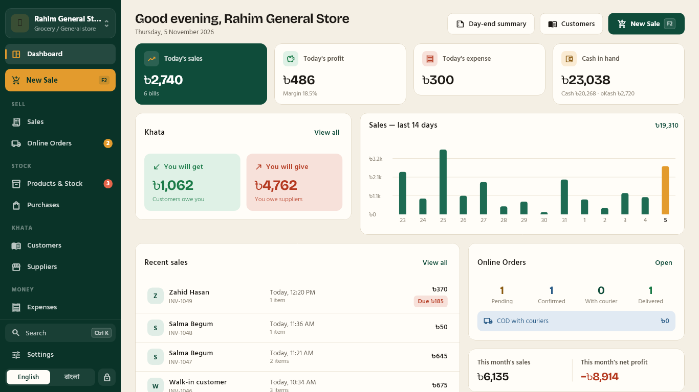

## Screenshots

<table>
  <tr>
    <td width="50%">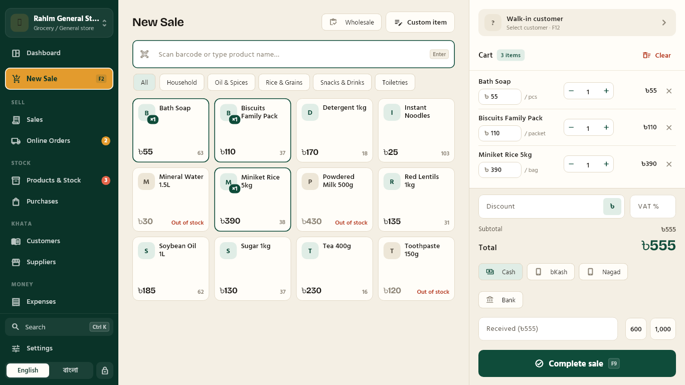<br><sub>Counter sale with barcode search, cart and payment</sub></td>
    <td width="50%">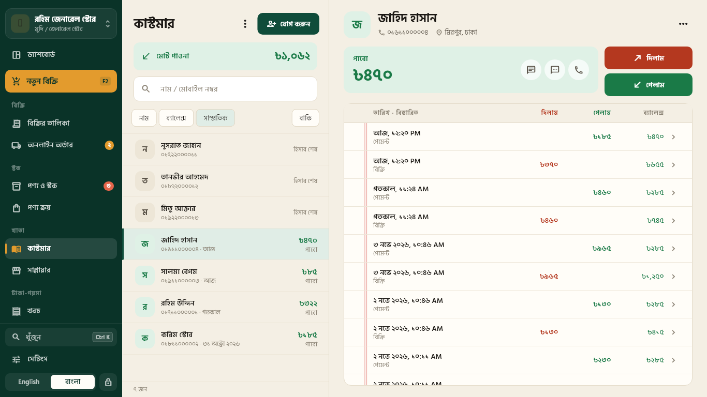<br><sub>Customer khata with running balance, in Bangla</sub></td>
  </tr>
  <tr>
    <td>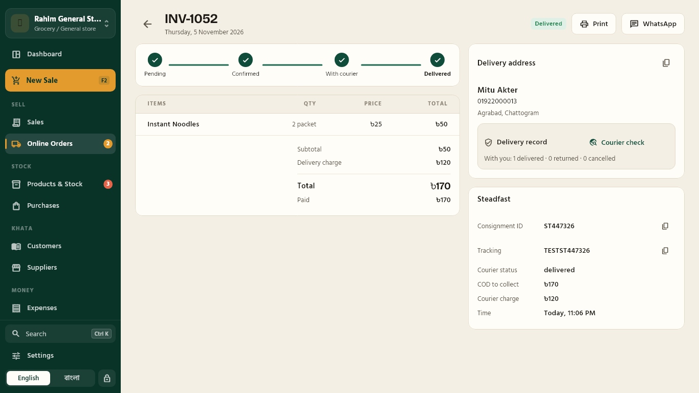<br><sub>Online order with courier tracking and delivery record</sub></td>
    <td>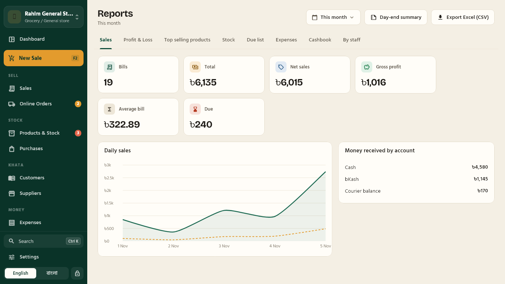<br><sub>Reports, with Excel (CSV) export</sub></td>
  </tr>
  <tr>
    <td>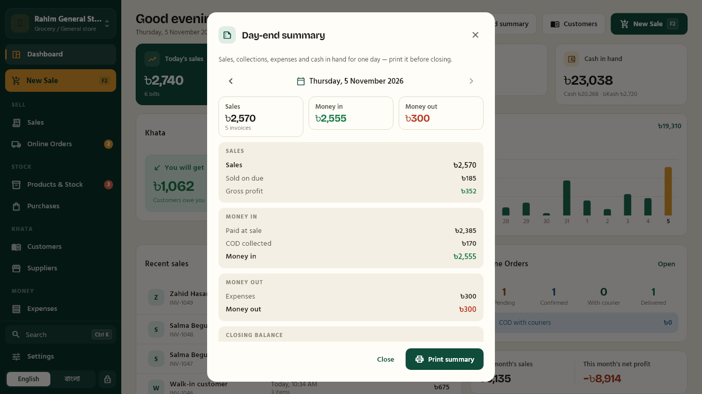<br><sub>Day-end summary, ready to print before closing</sub></td>
    <td>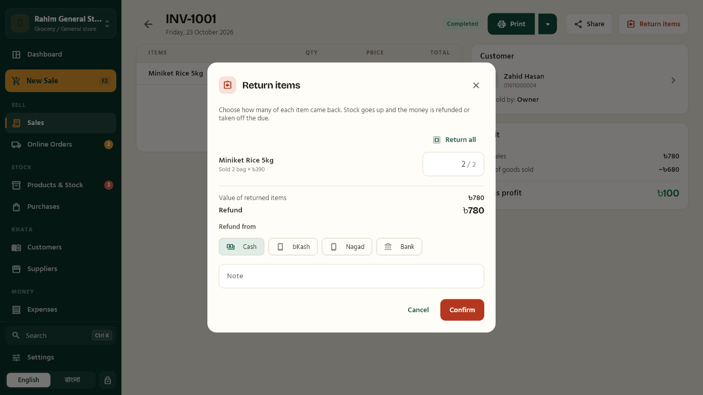<br><sub>Partial return with a refund preview</sub></td>
  </tr>
  <tr>
    <td>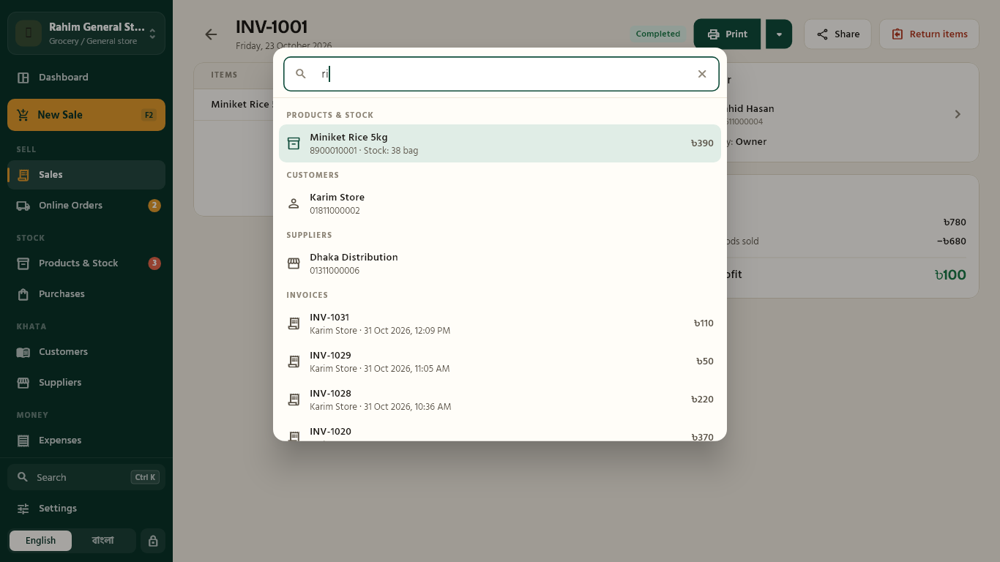<br><sub>Ctrl+K search across products, customers and invoices</sub></td>
    <td>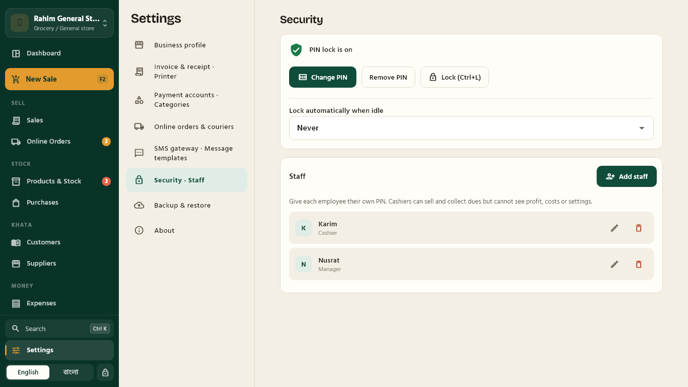<br><sub>Staff accounts, PINs and auto-lock</sub></td>
  </tr>
</table>

On a phone:

<table>
  <tr>
    <td>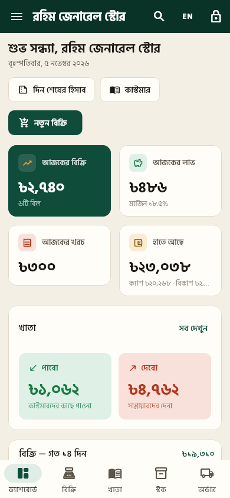</td>
    <td>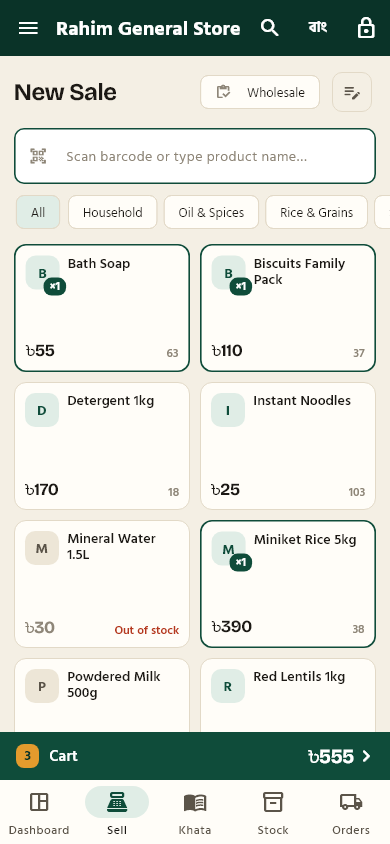</td>
    <td>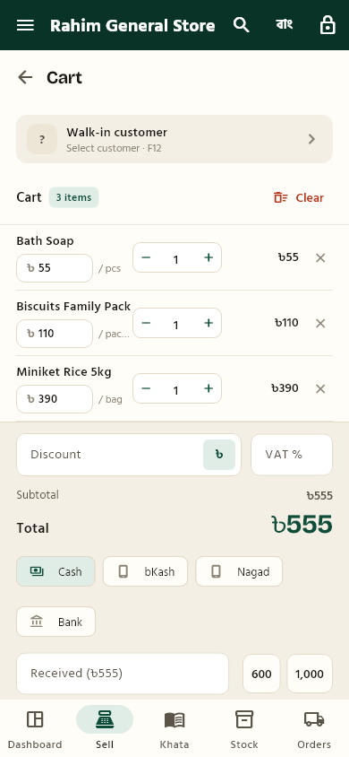</td>
    <td>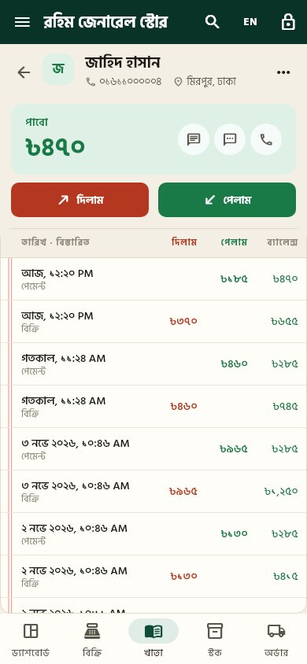</td>
  </tr>
</table>

The images are rendered from the built-in demo data by `test/shots_test.dart`, so all names and numbers in them are made up.

## Features

| Area | What it does |
|---|---|
| **New sale** (`F2`) | Barcode scanner or camera scan, product grid by category, custom items, wholesale prices, discount and VAT, Cash / bKash / Nagad / Bank, change calculation. Anything unpaid goes to the customer's khata. |
| **Sales and returns** | Invoice list, printing on 58 mm, 80 mm or A4, one-click printing to a saved printer, sharing as a picture, PDF, WhatsApp or SMS. Partial returns split the discount and VAT by value, put the stock back and take the refund off the due first. |
| **Khata** (`F4`) | Customers and suppliers with দিলাম / পেলাম entries, running balance, পাবো / দেবো totals, WhatsApp and SMS due reminders, printable statements, CSV import and export. |
| **Products and stock** (`F3`) | Categories, units, SKU, barcodes (generate EAN-13 or scan), photos, cost / sale / wholesale prices, weighted-average cost, low-stock alerts, stock history, stock counts, label printing, CSV import and export. |
| **Purchases** (`F6`) | Stock in from suppliers, updates the average cost, unpaid part goes to the supplier's khata, cancel with full reversal. |
| **Online orders** (`F5`) | Phone lookup with the customer's delivery record, booking with Steadfast, Pathao or RedX (one by one or in bulk), status sync, automatic COD settlement, partial delivery, returns, optional automatic SMS. |
| **Money** (`F7`, `F8`) | Expenses by category, any number of money accounts, cash in and out, transfers, full history. |
| **Reports** (`F10`) | Sales, profit and loss, top products, stock value, dues, expenses, cash book and sales by staff, exportable to CSV. Day-end summary on screen or on the receipt printer. |
| **Staff** | Owner PIN plus a PIN for each employee, Manager and Cashier roles, who-did-what on every record, auto-lock when idle. |
| **Everything else** | Several businesses in one app, daily automatic backups, sharing a backup to another device, `Ctrl+K` search, message templates with your bKash/Nagad numbers. Receipts are rendered as images so Bangla conjuncts come out correctly. |

## Getting started

No prebuilt downloads are published yet, so build it from source. You need:

- [Flutter](https://docs.flutter.dev/get-started/install) 3.47 or newer
- For Windows: Visual Studio with the **Desktop development with C++** workload, and Developer Mode turned on
- For Android: the Android SDK

```bash
git clone https://github.com/sakibhossain0/bizkhata.git
cd bizkhata
flutter pub get
flutter run -d windows
```

When the app opens, pick a language and a business type. **Explore with sample data** creates a demo shop, so you can look around without entering anything. To try the courier flow without real API keys, turn on **Test mode** under Settings → Online orders & couriers.

## Keyboard shortcuts

| Key | Action | Key | Action |
|---|---|---|---|
| `F2` | New sale | `F8` | Cashbox |
| `F3` | Products | `F9` or `Ctrl+Enter` | Complete the sale |
| `F4` | Customers | `F10` | Reports |
| `F5` | Online orders | `F12` | Select customer (in New sale) |
| `F6` | Purchases | `Ctrl+K` | Search everything |
| `F7` | Expenses | `Ctrl+N` | Add product (on the Products page) |
| `Ctrl+L` | Lock or switch user | `Ctrl+Home` | Home page |

## Staff roles

Set an owner PIN first, then add staff under Settings → Security · Staff. The lock screen then asks who is using the app.

| | Owner | Manager | Cashier |
|---|:---:|:---:|:---:|
| Sell, view stock, customers, online orders | ✓ | ✓ | ✓ |
| Collect dues and write khata entries | ✓ | ✓ | ✓ |
| See cost prices and profit | ✓ | ✓ | |
| Edit products and stock | ✓ | ✓ | |
| Returns and cancellations | ✓ | ✓ | |
| Delete khata entries, archive contacts | ✓ | ✓ | |
| Dashboard, purchases, suppliers, expenses, cashbox, reports | ✓ | ✓ | |
| Shop, invoice, courier and SMS settings | ✓ | ✓ | |
| Owner PIN, staff, backup and restore, deleting or switching business | ✓ | | |

## Couriers and SMS

| Courier | What you need | What works |
|---|---|---|
| Steadfast | API key and secret key | Booking, status sync, customer delivery record |
| Pathao | Client ID and secret, merchant email and password | Booking, status sync |
| RedX | API token | Booking, status sync |

Enter the keys under Settings → Online orders & couriers, then press **Test connection**. The adapters in `lib/couriers/` were checked against each courier's official API guide in October 2026.

SMS works with any provider that has an HTTP link. Paste the URL under Settings → SMS gateway with `{number}` and `{message}` where the values go.

## Data, backups and security

- Each business is one SQLite file. On Windows it is in `%APPDATA%\BizKhata\BizKhata\businesses\<id>\`, and on Android in the app's private storage.
- A backup is made automatically the first time you open a business each day, and the last 15 are kept. On Windows they go to `Documents\BizKhata Backups`, or to any folder you choose, such as a Google Drive folder. On a phone they stay inside the app, so use **Backup now** or **Share backup** to get a copy out.
- A deleted business stays under *Recently deleted* for 30 days and can be restored.
- **The database and backup files are not encrypted.** They hold your customer list and your courier API keys, so keep backups private. The PIN lock keeps people out of the app, not out of the file.
- Set the `BIZKHATA_DATA_DIR` environment variable to run a copy of the app on separate test data.

## How the numbers add up

- A contact's balance is the sum of their ledger entries. Above zero they owe you (পাবো), below zero you owe them (দেবো).
- Every taka entering or leaving an account is a cash transaction. An account's balance is its opening amount plus money in minus money out.
- Sales, purchases, returns and courier settlements write their stock moves, ledger entries and cash transactions in one database transaction.
- Revenue counts counter sales plus delivered online orders. Profit is net sales plus delivery charges minus the cost of goods, using weighted-average cost.
- A partial return reduces the sale itself. A full return keeps the original figures and marks the sale as returned, and reports leave it out.

## Project layout

```text
lib/
├── main.dart, app.dart      start-up, routes, boot / onboarding / lock phases
├── core/                    translations (English + Bangla), theme, formatting, window sizing
├── couriers/                Steadfast, Pathao and RedX adapters, plus a test-mode mock
├── data/
│   ├── database.dart        tables and migrations
│   ├── business_store.dart  one database per business, backup, restore, recently deleted
│   └── repos/               sales, products, contacts, cash, orders, purchases, expenses, reports, staff, settings
├── services/                printing, WhatsApp and SMS, message templates
├── state/                   app state (session, lock, language)
└── ui/                      shell, screens, shared widgets
test/                        automated tests
drift_schemas/               database snapshots for the migration test
installer/                   Inno Setup script for the Windows installer
docs/                        privacy policy, Play Store listing, screenshots
```

Built with Flutter, [drift](https://drift.simonbinder.eu/) (SQLite), [Riverpod](https://riverpod.dev/), [go_router](https://pub.dev/packages/go_router) and the [printing](https://pub.dev/packages/printing) and [pdf](https://pub.dev/packages/pdf) packages.

## Tests

```bash
flutter analyze
flutter test
```

| File | What it checks |
|---|---|
| `test/core_test.dart` | Invoices, stock, khata, cash and courier settlement add up |
| `test/v11_test.dart` | Partial-return maths, staff PINs and roles, courier rules |
| `test/migration_test.dart` | A version 1 database upgrades without losing data |
| `test/bugfix_test.dart` | Adding a product with stock, safe deletion of a business |
| `test/staff_ui_test.dart` | What a cashier can and cannot see |
| `test/screens_test.dart` | Every screen and the main dialogs in both languages at five window sizes, failing on any layout overflow |

`test/shots_test.dart` is skipped by default. It renders the screenshots into `test/goldens/`:

```bash
flutter test test/shots_test.dart --run-skipped --update-goldens
```

## Building releases

### Windows

```powershell
flutter build windows --release
& "C:\path\to\Inno Setup 6\ISCC.exe" installer\bizkhata.iss
```

`build\windows\x64\runner\Release\` is the portable app; keep the DLLs and the `data` folder next to the `.exe`. The installer lands in `build\installer\`. It installs per user, and uninstalling keeps your business data.

### Android

```powershell
flutter build apk --release --split-per-abi   # APKs to install directly
flutter build appbundle --release             # bundle for Google Play
```

Release builds fall back to the debug key unless `android/key.properties` exists. To sign with your own key:

```powershell
keytool -genkeypair -keystore upload.jks -storetype PKCS12 -keyalg RSA -keysize 2048 -validity 10000 -alias upload
```

```properties
# android/key.properties
storePassword=your-password
keyPassword=your-password
keyAlias=upload
storeFile=C:/path/to/upload.jks
```

Git ignores both files, so back them up yourself. An APK signed with a different key can't install over an existing copy: back up the shop's data, uninstall, install the new APK, then restore.

The store text and data-safety answers are in [docs/play-store-listing.md](docs/play-store-listing.md).

### Linux and macOS

The platform folders are included, but these builds haven't been tried yet. Flutter builds a desktop app only on the system it targets.

## Working on the code

- All user-facing text lives in `lib/core/i18n.dart`, in `enum T`, with English and Bangla side by side. Add both.
- Generated database code (`*.g.dart`) is committed, so a fresh clone builds without running `build_runner`.
- To change the database, edit `lib/data/database.dart`, bump `schemaVersion`, add the step to `onUpgrade`, then run:

  ```bash
  dart run build_runner build
  dart run drift_dev schema dump lib/data/database.dart drift_schemas/
  dart run drift_dev schema generate drift_schemas/ test/generated_migrations/
  ```

  and add the new version to `test/migration_test.dart`.
- Screens have to hold up from a 390 px wide phone to a 1366×768 laptop. `test/screens_test.dart` fails on layout overflows at those sizes.

## Status and plans

Windows is the main target. Android builds, and version 1.0 was run through a full sale on an emulator.

Not yet tried with real accounts or hardware: live courier bookings, SMS gateways, thermal printers, and camera scanning on a physical phone.

Ideas for later: cloud sync between devices, bKash/Nagad payment links, courier webhooks instead of manual status sync, Linux and macOS builds.

## License

No open-source license has been chosen, so all rights are reserved for now.

The bundled fonts, Hind Siliguri and Bricolage Grotesque, are under the SIL Open Font License. The license texts are in `assets/fonts/`.
